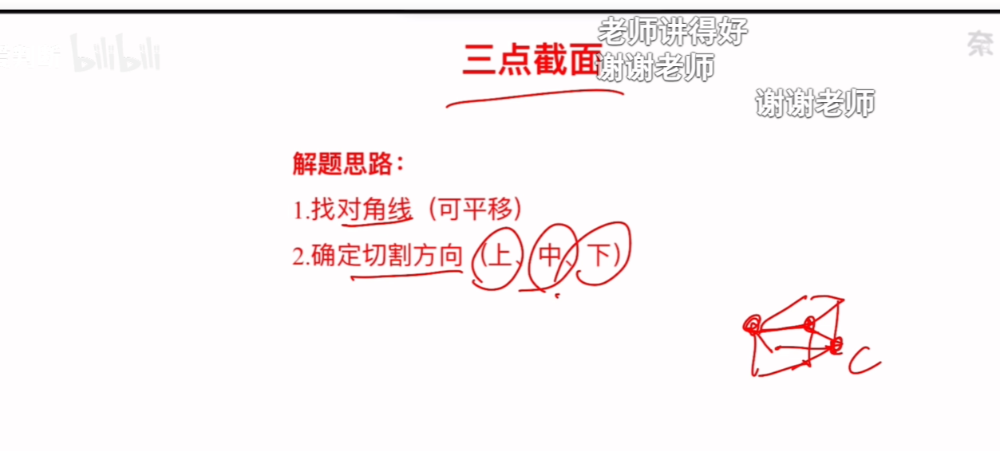
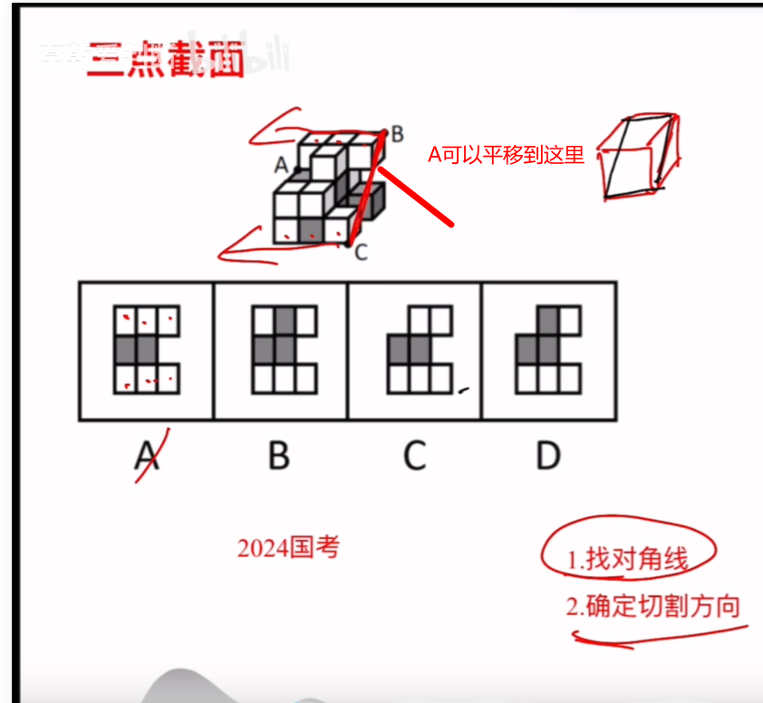
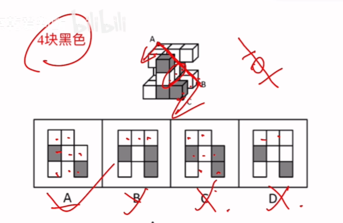
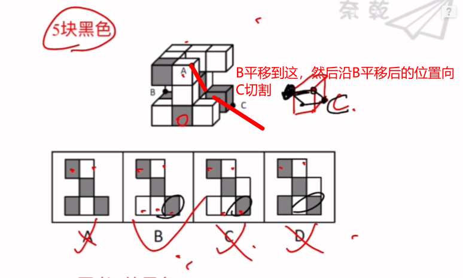
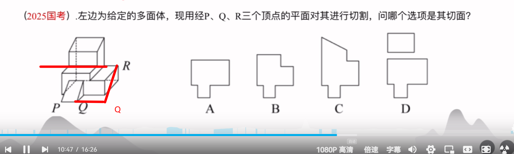

# 多面体切割

b站up主：[**判断-奈乾**](https://space.bilibili.com/3494360138123638/?spm_id_from=333.788.upinfo.detail.click)

[https://www.bilibili.com/video/BV1AjYjzpERh/?spm_id_from=333.1391.0.0](https://www.bilibili.com/video/BV1AjYjzpERh/?spm_id_from=333.1391.0.0)

思路是找对角线，不在同一个面的平移到一个面，然后根据剩下的点做切割，一般是给出3个点

步骤：连接B,C两点，然后A点作为切割方向，那么截面会经过b，c所在楞，会分成3行，上面的是白，白，白，下面是白，黑，白（可以平移，但是这个数量肯定得对上），只看第一，第三行的切面颜色基本可以排除，直接秒B。

这个连接BC，BA为切割方向，那么上面和下面分别为，白，白，空；黑，空，白；中间为白，白，黑，秒选A。

这种三个点不在一个平面的，先将某个点平移，然后共面了。将B平移，然后连接AB，那么BC为切割方向，A和C对应的楞就成了上下两行的截面，A的为黑，白，空；C的为黑，白，白。排除A，D，中间只有一个黑色的正方体，所以中间为黑，选B。

这种切割多面体的，思路也是平移，将Q平移和R共面，然后QP为切割方面，可见切割的话都是连续的，线都是平直的，排除B，C,D，秒A

